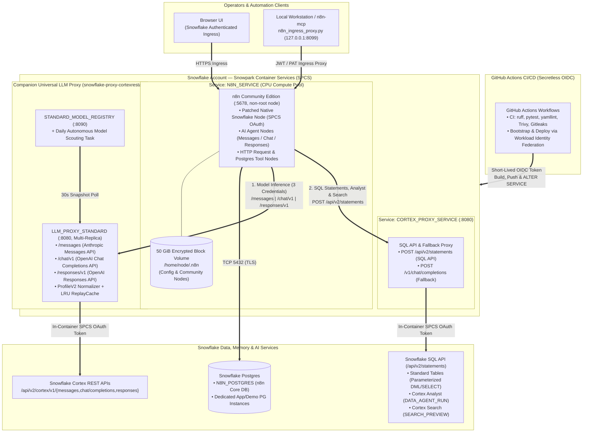
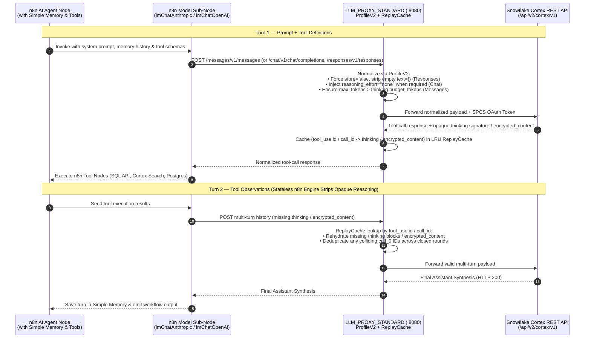
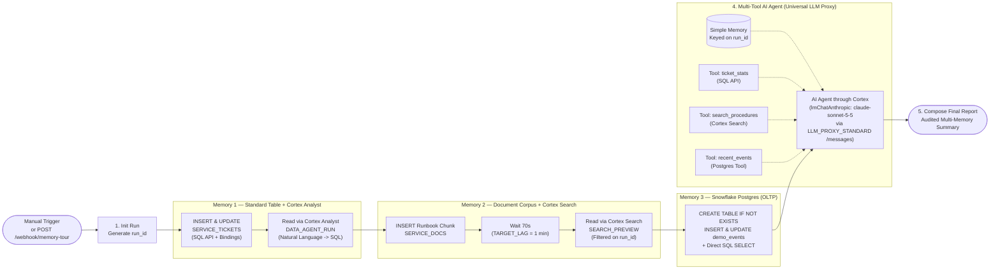

<div align="center">

# n8n on Snowflake (SPCS)

**Production-Grade Deployment of n8n Community Edition on Snowflake Snowpark Container Services (SPCS) with Snowflake Postgres, Multi-API Universal Cortex LLM Proxy (`Messages` | `Chat` | `Responses`), Persistent Block Storage & Passwordless GitHub OIDC**

[](LICENSE)
[](https://docs.snowflake.com/en/developer-guide/snowpark-container-services/overview)
[](https://github.com/fbattaglieri-snowflake/snowflake-proxy-cortexrestapi)
[](docs/cortex-proxy.md)
[](#quickstart--local-validation)

</div>

---

> [!WARNING]
> ### IMPORTANT DISCLAIMER — NOT AN OFFICIAL SNOWFLAKE OR N8N PRODUCT
> **This independent project was developed and is maintained by Francesco Battaglieri, with the assistance of Snowflake Cortex Code.**
> - It is **not** an official Snowflake or n8n release, product, service, publication, integration, reference architecture, or support offering.
> - **Neither Snowflake Inc. nor n8n GmbH, nor the n8n project maintainers, reviewed, approved, sponsored, endorsed, certified, authorized, commissioned, or warranted this project.**
> - They are not responsible for its code, documentation, security, maintenance, support, deployment, operation, or results. Use is entirely at your own risk. See [DISCLAIMER.md](DISCLAIMER.md) for the full no-warranty, limitation-of-liability, non-affiliation, and user-responsibility terms.

> [!IMPORTANT]
> ### MULTI-API UNIVERSAL CORTEX PROXY — [`snowflake-proxy-cortexrestapi`](https://github.com/fbattaglieri-snowflake/snowflake-proxy-cortexrestapi)
> To unlock the complete **Snowflake Cortex REST API** surface inside n8n across all three protocol families (**Anthropic Messages** `/messages`, **OpenAI Chat Completions** `/chat/v1`, and **OpenAI Responses** `/responses/v1`) with dynamic model discovery, stateless multi-turn tool-loop rehydration (`ReplayCache`), `32 MiB` payload budgets, and autonomous daily model scouting/promotion, this deployment integrates with the companion SPCS proxy:
> - **Universal Multi-API LLM Proxy (Recommended):** [**`fbattaglieri-snowflake/snowflake-proxy-cortexrestapi`**](https://github.com/fbattaglieri-snowflake/snowflake-proxy-cortexrestapi) (`LLM_PROXY_STANDARD :8080` + `STANDARD_MODEL_REGISTRY :8090`)
> - **Model Qualification Harness:** [**`fbattaglieri-snowflake/cortex-model-compatibility-matrix`**](https://github.com/fbattaglieri-snowflake/cortex-model-compatibility-matrix)
> - **Bundled SQL API & Fallback Proxy:** This repository also ships `proxy/cortex/cortex_proxy.py` (`CORTEX_PROXY_SERVICE :8080`) to forward Snowflake SQL API statements (`POST /api/v2/statements`) for standard tables, Cortex Analyst (`DATA_AGENT_RUN`), and Cortex Search (`SEARCH_PREVIEW`), while providing a lightweight `/v1/chat/completions` fallback.

---

## Table of Contents

1. [Executive Overview & Why This Architecture Exists](#1-executive-overview--why-this-architecture-exists)
2. [End-to-End Platform Architecture (Visual Schematics)](#2-end-to-end-platform-architecture)
3. [Multi-API Cortex Model Routing (`Messages` / `Chat` / `Responses`)](#3-multi-api-cortex-model-routing-messages--chat--responses)
4. [Snowflake Memory Tour: One Agent Over Three Snowflake Memories](#4-snowflake-memory-tour-one-agent-over-three-snowflake-memories)
5. [Included Capabilities](#5-included-capabilities)
6. [Prerequisites & Cross-Region Inference (`ANY_REGION`)](#6-prerequisites--cross-region-inference-any_region)
7. [Deployment Flow (GitHub Actions OIDC)](#7-deployment-flow-github-actions-oidc)
8. [Design Decisions](#8-design-decisions)
9. [Quickstart & Local Validation](#quickstart--local-validation)
10. [Documentation & Examples](#documentation--examples)

---

## 1. Executive Overview & Why This Architecture Exists

Running **n8n Community Edition** inside **Snowpark Container Services (SPCS)** — with zero external LLM providers, zero static Snowflake credentials inside workflows, and full access to **Cortex LLMs**, **Cortex Analyst**, **Cortex Search**, **Standard Tables**, and **Snowflake Postgres** — requires solving five concrete platform constraints:

| # | Platform Challenge | What Happens Without This Architecture | How `n8n-snowflake` Solves It |
|---|---|---|---|
| **1** | **SPCS Forbids Bearer PATs Inside Containers** | Calling Snowflake REST endpoints from an SPCS container with a Programmatic Access Token fails with `Please use OAuth when connecting to Snowflake`. | Both the patched native n8n Snowflake node (`docker/n8n/patch-snowflake-spcs-oauth.js`) and the internal SPCS proxies read the rotating `/snowflake/session/token` (`authenticator=OAUTH`) on every request. |
| **2** | **Three Distinct Cortex LLM Wire Protocols** | Claude models speak **Anthropic Messages** (`/messages`), GPT-6 reasoning models speak **OpenAI Responses** (`/responses`), and Chat models speak **Chat Completions** (`/chat/completions`). | Connects n8n to [**`snowflake-proxy-cortexrestapi`**](https://github.com/fbattaglieri-snowflake/snowflake-proxy-cortexrestapi) via three dedicated internal SPCS credentials (`/messages`, `/chat/v1`, `/responses/v1`), each with live `/models` dropdown discovery. |
| **3** | **Stateless n8n Agent Tool-Loop Stripping** | Unmodified n8n agent execution strips `reasoning.encrypted_content` (Responses) and `thinking` signatures (Messages) between tool calls, causing `HTTP 400` on turn 2. | `LLM_PROXY_STANDARD`'s bounded in-memory **`ReplayCache`** keys opaque reasoning and thinking blocks by `call_id` / `tool_use.id` and rehydrates them automatically on continuation turns. |
| **4** | **Client Parameter Mismatches (`HTTP 400`)** | n8n's `lmChatOpenAi` sends `store: true` and empty `text: {}` on Responses, or `reasoning_effort` on Chat models that require `"none"` when tools are bound. | `ProfileV2` normalization in `LLM_PROXY_STANDARD` forces `store=false`, strips empty `text={}`, normalizes `reasoning_effort`, and deduplicates colliding `call_0` tool IDs across turns. |
| **5** | **Durable State Across Container Upgrades** | Ephemeral container filesystems lose workflows, credentials, execution logs, and installed community nodes on reschedule or redeploy. | Stores all transactional workflow/execution state in **Snowflake Postgres** (`N8N_POSTGRES`) and mounts a **50 GiB encrypted SPCS Block Volume** at `/home/node/.n8n`. |

---

## 2. End-to-End Platform Architecture



### ASCII Quick-Reference Schematic

```text
+---------------------------------------------------------------------------------------------------+
|  OPERATORS & CI/CD                                                                                |
|  • Browser UI ──────────────────────────────> Snowflake Public Ingress ──> N8N_SERVICE (:5678)    |
|  • Local CLI / n8n-mcp ──> 127.0.0.1:8099 ──> Snowflake Public Ingress ──> N8N_SERVICE (:5678)    |
|  • GitHub Actions OIDC ─────────────────────> Image Registry + ALTER SERVICE                      |
+---------------------------------------------------------------------------------------------------+
                                                  |
         +----------------------------------------+----------------------------------------+
         |                                        |                                        |
         v (Model Inference — 3 APIs)             v (SQL, Analyst & Search)                v (TCP :5432 TLS)
+------------------------------------+  +------------------------------------+  +-----------------------+
| LLM_PROXY_STANDARD (:8080)         |  | CORTEX_PROXY_SERVICE (:8080)       |  | SNOWFLAKE POSTGRES    |
| • /messages     (Claude 5.5 family)|  | • POST /api/v2/statements          |  | • n8n Core Metadata   |
| • /chat/v1      (GPT-6 / Grok / ..)|  |   - Standard Tables (Bindings)     |  |   & Execution History |
| • /responses/v1 (GPT-6.1 / Astra)  |  |   - Cortex Analyst (DATA_AGENT_RUN)|  | • Workflow OLTP State |
| • ProfileV2 + LRU ReplayCache      |  |   - Cortex Search (SEARCH_PREVIEW) |  |   (e.g. demo_events)  |
+-----------------+------------------+  +-----------------+------------------+  +-----------------------+
                  |                                       |
                  v (SPCS OAuth Token)                    v (SPCS OAuth Token)
+------------------------------------+  +------------------------------------+
| SNOWFLAKE CORTEX REST API          |  | SNOWFLAKE SQL API                  |
| /api/v2/cortex/v1/{messages,       |  | /api/v2/statements                 |
|   chat/completions,responses}      |  |                                    |
+------------------------------------+  +------------------------------------+
```

---

## 3. Multi-API Cortex Model Routing (`Messages` / `Chat` / `Responses`)

In n8n, configure **three internal credentials** pointing to `LLM_PROXY_STANDARD` (`http://<llm-proxy-standard-dns>:8080`). Because the proxy authenticates upstream using its rotating SPCS service OAuth token, the `API Key` in n8n is a non-secret placeholder (`internal-spcs`):

| n8n Credential Name | Credential Type | n8n Model Node | Base URL (`ORIGIN = http://<llm-proxy-standard-dns>:8080`) | Node Setting | Target Model Examples |
|---|---|---|---|---|---|
| **`Snowflake Cortex Standard - Messages (/messages)`** | `Anthropic` (`anthropicApi`) | **Anthropic Chat Model** (`lmChatAnthropic`) | `ORIGIN/messages` | Default (`maxTokensToSample: 4096`) | `claude-sonnet-5-5`, `claude-opus-5-5`, `claude-haiku-5-5` |
| **`Snowflake Cortex Standard - Chat (/chat/v1)`** | `OpenAI` (`openAiApi`) | **OpenAI Chat Model** (`lmChatOpenAi`) | `ORIGIN/chat/v1` | **Use Responses API: `OFF`** (`responsesApiEnabled: false`, leave `maxTokens` unset) | `openai-gpt-6-luna`, `openai-gpt-6-sol`, `grok-4.7`, `grok-4.6`, `glm-5.3`, `kimi-k3` |
| **`Snowflake Cortex Standard - Responses (/responses/v1)`** | `OpenAI` (`openAiApi`) | **OpenAI Chat Model** (`lmChatOpenAi`) | `ORIGIN/responses/v1` | **Use Responses API: `ON`** (`responsesApiEnabled: true`, leave `maxTokens` unset) | `openai-gpt-6.1-terra`, `openai-gpt-6.1-sol`, `openai-gpt-6-astra` |



> [!TIP]
> **Why leave `Maximum Number of Tokens` (`maxTokens`) unset on `lmChatOpenAi` for Cortex Chat?**
> When `maxTokens` is populated in n8n's `OpenAI Chat Model` options, n8n emits the legacy `"max_tokens"` JSON key, which Snowflake Cortex's `/chat/completions` endpoint rejects in favor of `"max_completion_tokens"`. Leaving `maxTokens` unset (or passing `{"max_completion_tokens": 4096}` via `Extra Body`) avoids the parameter conflict completely.

---

## 4. Snowflake Memory Tour: One Agent Over Three Snowflake Memories

The repository includes a complete, production-tested showcase workflow in [`examples/memory-tour`](examples/memory-tour) that writes to and reads back from all three Snowflake data/memory layers — plus n8n's conversation memory — and then synthesizes an audited report with a Cortex-served AI Agent:



---

## 5. Included Capabilities

- **Reproducible n8n CE image** pinned to an upstream release with automated security floor verification.
- **Native n8n Snowflake node authentication** through `/snowflake/session/token` (`authenticator=OAUTH`).
- **Snowflake Postgres** as the durable n8n metadata and execution database, plus support for dedicated workload Postgres instances.
- **Persistent 50 GiB SPCS block storage** for local n8n state and community nodes.
- **Snowflake Secrets** for the Postgres password and n8n encryption key (never exposed in GitHub logs or workflow files).
- **Multi-API Universal Cortex Proxy integration** (`/messages`, `/chat/v1`, `/responses/v1`) via [`snowflake-proxy-cortexrestapi`](https://github.com/fbattaglieri-snowflake/snowflake-proxy-cortexrestapi) plus bundled SQL API proxy (`POST /api/v2/statements`).
- **AI Agents powered 100% by Snowflake Cortex**, with zero external LLM providers in the data path.
- **Documented, battle-tested patterns** for every Snowflake capability: standard tables, Snowflake Postgres, Cortex Analyst, Cortex Search, Cortex Agents, and multi-protocol LLM inference.
- **Local ingress proxy** (`proxy/ingress/n8n_ingress_proxy.py`) for managing the n8n REST API and `n8n-mcp` through Snowflake ingress.
- **Secretless GitHub-to-Snowflake CI/CD** using OpenID Connect (OIDC) workload identity federation.

---

## 6. Prerequisites & Cross-Region Inference (`ANY_REGION`)

1. A Snowflake account with **Snowpark Container Services** and **Snowflake Postgres** available.
2. Enable **Cross-Region Inference** (`ANY_REGION`) so all qualified Claude, OpenAI GPT, Grok, GLM, and Kimi models are routable through the Cortex REST APIs:
   ```sql
   ALTER ACCOUNT SET CORTEX_ENABLED_CROSS_REGION = 'ANY_REGION';
   ```
3. A role allowed to perform the one-time OIDC trust setup (`infrastructure/sql/00_oidc_trust.sql`).
4. Docker or another OCI-compatible builder that can produce `linux/amd64` images.
5. A Postgres ingress CIDR that reaches the Snowflake Postgres endpoint from the selected SPCS compute pool (do not use `0.0.0.0/0` in production).

---

## 7. Deployment Flow (GitHub Actions OIDC)

1. Fork or clone the repository.
2. Review [docs/security.md](docs/security.md) and [docs/configuration.md](docs/configuration.md).
3. Run the one-time trust setup in `infrastructure/sql/00_oidc_trust.sql` as an account administrator.
4. Create the `bootstrap` and `production` GitHub environments and restrict their reviewers to the repository maintainer.
5. Configure repository variables described in [docs/configuration.md](docs/configuration.md). No Snowflake credential is stored in GitHub.
6. Run the **Bootstrap Snowflake** workflow manually.
7. Run the **Deploy to Snowflake** workflow manually and approve the `production` environment.
8. Deploy the companion Universal LLM Proxy from [**`snowflake-proxy-cortexrestapi`**](https://github.com/fbattaglieri-snowflake/snowflake-proxy-cortexrestapi) and register the three n8n credentials (`/messages`, `/chat/v1`, `/responses/v1`).

---

## 8. Design Decisions

- **No long-lived Snowflake credential in GitHub.** GitHub OIDC tokens are short-lived and scoped to protected environments.
- **No Postgres password in workflow output.** Initial credentials are captured and converted into Snowflake Secret objects within a single Snowflake session.
- **No account-specific defaults.** Names, regions, endpoints, and roles are supplied as variables.
- **No public LLM or SQL proxy.** n8n reaches `LLM_PROXY_STANDARD` and `CORTEX_PROXY_SERVICE` exclusively over private SPCS DNS (`.svc.spcs.internal`).
- **No destructive upgrade.** Deployments use `ALTER SERVICE`; they never drop the n8n service or its block volume.
- **Immutable deployment tags.** Images use the Git commit SHA rather than mutable tags.

---

## Quickstart & Local Validation

Run the local validation suite (syntax, `ruff`, `pytest`, `yamllint`, and secret-pattern checks) before pushing any change:

```bash
./scripts/validate.sh
```

---

## Documentation & Examples

| Document | Scope |
|---|---|
| [**Architecture**](docs/architecture.md) | Runtime components, dual-proxy topology (`LLM_PROXY_STANDARD` + `CORTEX_PROXY_SERVICE`), Snowflake Postgres, and network boundaries |
| [**Cortex & SQL Proxy Guide**](docs/cortex-proxy.md) | Configuring the 3 Universal LLM Proxy credentials (`/messages`, `/chat/v1`, `/responses/v1`), direct HTTP Request payloads, and SQL API forwarding |
| [**Building Workflows Guide**](docs/building-workflows.md) | End-to-end patterns and pitfalls for Standard Tables, Snowflake Postgres, Cortex Analyst, Cortex Search, Cortex Agents, and n8n AI Agents |
| [**Snowflake Memory Tour Example**](examples/memory-tour) | Ready-to-import workflow (`workflow.json`) + SQL setup demonstrating all three Snowflake memories and a multi-tool Cortex AI Agent |
| [**Configuration**](docs/configuration.md) | GitHub Actions variables, OIDC setup, and environment parameters |
| [**Security**](docs/security.md) | Threat model, secret management, OIDC trust boundaries, and SQL parameter binding rules |
| [**Operations & Backup/Recovery**](docs/operations.md) | Suspend/resume runbooks, container readiness checks, and [backup/recovery procedures](docs/backup-recovery.md) |
| [**n8n REST & MCP Management**](docs/n8n-management.md) | Connecting local tools and `n8n-mcp` via `proxy/ingress/n8n_ingress_proxy.py` |
| [**Troubleshooting**](docs/troubleshooting.md) | Concrete symptoms, root causes, and verified fixes from production SPCS deployments |

---

## License

Repository-authored code and documentation are licensed under [Apache-2.0](LICENSE). n8n and all other upstream dependencies retain their own licenses. Review [DISCLAIMER.md](DISCLAIMER.md) and [NOTICE](NOTICE) before using or redistributing this project.
