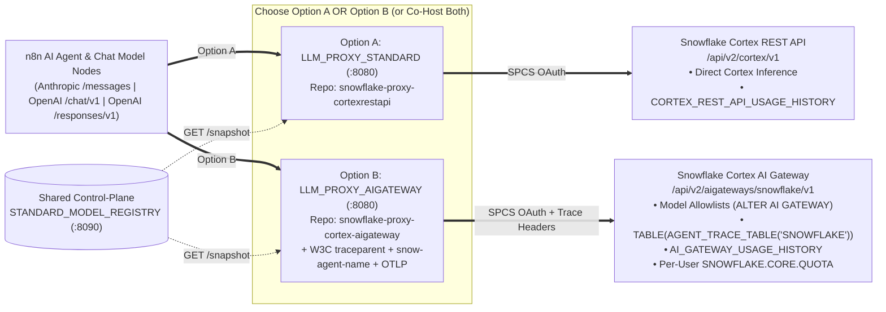
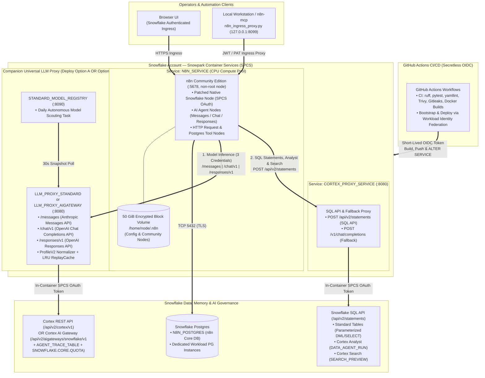

<div align="center">

# n8n on Snowflake (SPCS)

**Production-Grade Deployment of n8n Community Edition on Snowflake Snowpark Container Services (SPCS) with Snowflake Postgres, Cortex REST API Proxy or Cortex AI Gateway Proxy (`Messages` | `Chat` | `Responses`), Persistent Block Storage & Passwordless GitHub OIDC**

[](LICENSE)
[](https://docs.snowflake.com/en/developer-guide/snowpark-container-services/overview)
[](https://github.com/fbattaglieri-snowflake/snowflake-proxy-cortexrestapi)
[](https://github.com/fbattaglieri-snowflake/snowflake-proxy-cortex-aigateway)
[](#quickstart--local-validation)

</div>

---

> [!WARNING]
> ### IMPORTANT DISCLAIMER — NOT AN OFFICIAL SNOWFLAKE OR N8N PRODUCT
> **This independent project was developed and is maintained by Francesco Battaglieri, with the assistance of Snowflake Cortex Code.**
> - It is **not** an official Snowflake or n8n release, product, service, publication, integration, reference architecture, or support offering.
> - **Neither Snowflake Inc. nor n8n GmbH, nor the n8n project maintainers, reviewed, approved, sponsored, endorsed, certified, authorized, commissioned, or warranted this project.**
> - They are not responsible for its code, documentation, security, maintenance, support, deployment, operation, or results. Use is entirely at your own risk. See [DISCLAIMER.md](DISCLAIMER.md) for the full no-warranty, limitation-of-liability, non-affiliation, and user-responsibility terms.

> [!IMPORTANT]
> ### MANDATORY LLM INFERENCE LAYER — DEPLOY **EITHER** PROXY **OR** AI GATEWAY PROXY
> Because Snowpark Container Services (SPCS) forbids static bearer PATs inside containers (`Please use OAuth when connecting to Snowflake`) and unmodified n8n nodes require `/v1/models` discovery, `ProfileV2` parameter normalization, `OrderedItems` SSE stabilization, and `ReplayCache` multi-turn tool-loop rehydration, **you must deploy at least ONE of the two companion Universal LLM Proxies** alongside n8n:
>
> - **Option A — Cortex REST API Proxy:** [**`fbattaglieri-snowflake/snowflake-proxy-cortexrestapi`**](https://github.com/fbattaglieri-snowflake/snowflake-proxy-cortexrestapi) &rarr; routes to **[Snowflake Cortex REST API](https://docs.snowflake.com/en/user-guide/snowflake-cortex/cortex-rest-api)** (`/api/v2/cortex/v1`)
> - **Option B — Cortex AI Gateway Proxy:** [**`fbattaglieri-snowflake/snowflake-proxy-cortex-aigateway`**](https://github.com/fbattaglieri-snowflake/snowflake-proxy-cortex-aigateway) &rarr; routes to **[Snowflake Cortex AI Gateway](https://docs.snowflake.com/en/user-guide/snowflake-cortex/ai-gateway)** (`/api/v2/aigateways/snowflake/v1`) with centralized model allowlists, OpenTelemetry traces (`TABLE(AGENT_TRACE_TABLE('SNOWFLAKE'))`), and blocking per-user `SNOWFLAKE.CORE.QUOTA` limits
> - *(Optional)* **Deploy Both at Zero Extra Compute Cost:** Both proxies can run side by side on the same `CPU_X64_XS` compute pool sharing a single **`STANDARD_MODEL_REGISTRY (:8090)`**.
> - **Bundled SQL API Proxy (`CORTEX_PROXY_SERVICE :8080`):** Included directly in this repository (`proxy/cortex/cortex_proxy.py`) to forward parameterized Snowflake SQL API statements (`POST /api/v2/statements`) for standard tables, Cortex Analyst (`DATA_AGENT_RUN`), and Cortex Search (`SEARCH_PREVIEW`).

---

## Table of Contents

1. [Executive Overview & Platform Challenges Solved](#1-executive-overview--platform-challenges-solved)
2. [Choosing Your LLM Layer: Cortex REST API Proxy vs. Cortex AI Gateway Proxy](#2-choosing-your-llm-layer-cortex-rest-api-proxy-vs-cortex-ai-gateway-proxy)
3. [End-to-End Platform Architecture (Mermaid & ASCII)](#3-end-to-end-platform-architecture)
4. [Multi-API Cortex Model Routing in n8n (`Messages` / `Chat` / `Responses`)](#4-multi-api-cortex-model-routing-in-n8n-messages--chat--responses)
5. [Ready-to-Run Examples with Synthetic Data & Least-Privilege Roles](#5-ready-to-run-examples-with-synthetic-data--least-privilege-roles)
6. [Prerequisites & Official Snowflake Documentation](#6-prerequisites--official-snowflake-documentation)
7. [Deployment Flow (GitHub Actions OIDC)](#7-deployment-flow-github-actions-oidc)
8. [Quickstart & Local Validation](#quickstart--local-validation)
9. [Documentation Index](#documentation-index)

---

## 1. Executive Overview & Platform Challenges Solved

Running **n8n Community Edition** inside **Snowpark Container Services (SPCS)** — with zero external LLM providers, zero static Snowflake credentials inside workflows, and full access to **Cortex LLMs**, **Cortex AI Gateway**, **Cortex Analyst**, **Cortex Search**, **Standard Tables**, and **Snowflake Postgres** — requires solving five concrete platform constraints:

| # | Platform Challenge | What Happens Without This Architecture | How `n8n-snowflake` Solves It |
|---|---|---|---|
| **1** | **SPCS Forbids Bearer PATs Inside Containers** | Calling Snowflake REST endpoints from an SPCS container with a Programmatic Access Token fails with `Please use OAuth when connecting to Snowflake`. | Both the patched native n8n Snowflake node (`docker/n8n/patch-snowflake-spcs-oauth.js`) and the internal SPCS proxies read the rotating `/snowflake/session/token` (`authenticator=OAUTH`) on every request. |
| **2** | **No `/v1/models` Discovery & Three Distinct Wire Protocols** | Raw `/api/v2/cortex/v1` and `/api/v2/aigateways/snowflake/v1` return `HTTP 404` on `GET /v1/models`, and Claude, GPT Chat, and GPT Responses require three separate APIs. | Connects n8n to **Option A (`snowflake-proxy-cortexrestapi`)** or **Option B (`snowflake-proxy-cortex-aigateway`)** via three internal credentials (`/messages`, `/chat/v1`, `/responses/v1`), each serving live `/models` dropdown discovery. |
| **3** | **Stateless n8n Agent Tool-Loop Stripping** | Unmodified n8n agent execution strips `reasoning.encrypted_content` (Responses) and `thinking` signatures (Messages) between tool calls, causing `HTTP 400` on turn 2. | The proxy's bounded in-memory **`ReplayCache`** keys opaque reasoning and thinking blocks by `call_id` / `tool_use.id` and rehydrates them automatically on continuation turns. |
| **4** | **Client Parameter Mismatches (`HTTP 400`)** | n8n emits `store: true` and empty `text: {}` on Responses, legacy `max_tokens` on Chat, or `temperature` alongside Claude 5.x `adaptive` thinking. | **`ProfileV2` Normalization** rewrites, clamps (`1..128000`), upgrades small token defaults (`32768` on mandatory-adaptive Claude 5.x), deduplicates `call_0` IDs, and retries transient `HTTP 429/503/529` responses. |
| **5** | **Durable State Across Container Upgrades** | Ephemeral container filesystems lose workflows, credentials, execution logs, and installed community nodes on reschedule or redeploy. | Stores all transactional workflow/execution state in **Snowflake Postgres** (`N8N_POSTGRES`) and mounts a **50 GiB encrypted SPCS Block Volume** at `/home/node/.n8n`. |

---

## 2. Choosing Your LLM Layer: Cortex REST API Proxy vs. Cortex AI Gateway Proxy

Snowflake exposes two distinct upstream inference endpoints inside your account. Both companion proxies expose the **exact same three client surfaces** (`/messages`, `/chat/v1`, `/responses/v1`) to n8n — you simply choose which governance model fits your deployment:



| Capability / Dimension | Option A: Cortex REST API Proxy ([`snowflake-proxy-cortexrestapi`](https://github.com/fbattaglieri-snowflake/snowflake-proxy-cortexrestapi)) | Option B: Cortex AI Gateway Proxy ([`snowflake-proxy-cortex-aigateway`](https://github.com/fbattaglieri-snowflake/snowflake-proxy-cortex-aigateway)) |
|---|---|---|
| **Official Snowflake Feature** | [Snowflake Cortex REST API](https://docs.snowflake.com/en/user-guide/snowflake-cortex/cortex-rest-api) | [Snowflake Cortex AI Gateway](https://docs.snowflake.com/en/user-guide/snowflake-cortex/ai-gateway) |
| **Upstream Snowflake Path** | `https://<host>/api/v2/cortex/v1` | `https://<host>/api/v2/aigateways/<gateway>/v1` |
| **Centralized Model Allowlist** | Account-level `CORTEX_MODELS_ALLOWLIST` + Registry catalog | Gateway-level YAML policy (`ALTER AI GATEWAY SNOWFLAKE SET SPECIFICATION`) |
| **OpenTelemetry Server Spans** | Not recorded in `AGENT_TRACE_TABLE` | Recorded in `TABLE(AGENT_TRACE_TABLE('SNOWFLAKE'))` with full request/response capture & PII tag exclusion |
| **Agent & Trace Correlation** | Proxy response headers (`x-request-id`, `x-proxy-adjustments`) | Auto-synthesizes 128-bit W3C `traceparent` + maps `API Key: client:<agent>` &rarr; `snow-agent-name` + OTLP `POST /telemetry/v1/traces` |
| **Cost & Token Attribution View** | `SNOWFLAKE.ACCOUNT_USAGE.CORTEX_REST_API_USAGE_HISTORY` | `SNOWFLAKE.ACCOUNT_USAGE.AI_GATEWAY_USAGE_HISTORY` |
| **Blocking Per-User Quotas** | Account/Warehouse budgets | Enforced via `SNOWFLAKE.CORE.QUOTA` (`ADD_SHARED_RESOURCE('AI GATEWAY')`) |
| **Required Snowflake Privilege** | `SNOWFLAKE.CORTEX_USER` or `SNOWFLAKE.CORTEX_REST_API_USER` | `USAGE` on `AI GATEWAY <name>` (`MONITOR` to query traces) |
| **`ProfileV2` + `OrderedItems` + `ReplayCache`** | Included | Included |
| **Recommended When** | You want minimal setup and direct Cortex REST inference without gateway policy objects | You want per-workflow OpenTelemetry traces in Snowflake, gateway-scoped model allowlists, and per-user quotas |

See [**`docs/cortex-proxy.md`**](docs/cortex-proxy.md) for the complete credential configuration and SQL governance commands for both options.

---

## 3. End-to-End Platform Architecture



### ASCII Quick-Reference Schematic

```text
+---------------------------------------------------------------------------------------------------+
|  OPERATORS & CI/CD                                                                                |
|  • Browser UI ──────────────────────────────> Snowflake Public Ingress ──> N8N_SERVICE (:5678)    |
|  • Local CLI / n8n-mcp ──> 127.0.0.1:8099 ──> Snowflake Public Ingress ──> N8N_SERVICE (:5678)    |
|  • GitHub Actions OIDC ─────────────────────> Image Registry + ALTER SERVICE                      |
+---------------------------------------------------------------------------------------------------+
                                                  |
         +----------------------------------------+----------------------------------------+
         |                                        |                                        |
         v (Model Inference — 3 APIs)             v (SQL, Analyst & Search)                v (TCP :5432 TLS)
+------------------------------------+  +------------------------------------+  +-----------------------+
| OPTION A: LLM_PROXY_STANDARD (:8080|  | CORTEX_PROXY_SERVICE (:8080)       |  | SNOWFLAKE POSTGRES    |
| OPTION B: LLM_PROXY_AIGATEWAY(:8080|  | • POST /api/v2/statements          |  | • n8n Core Metadata   |
| • /messages     (Claude 5.5 family)|  |   - Standard Tables (Bindings)     |  |   & Execution History |
| • /chat/v1      (GPT-6 / Grok / ..)|  |   - Cortex Analyst (DATA_AGENT_RUN)|  | • Workflow OLTP State |
| • /responses/v1 (GPT-6.1 / Astra)  |  |   - Cortex Search (SEARCH_PREVIEW) |  |   (e.g. demo_events)  |
+-----------------+------------------+  +-----------------+------------------+  +-----------------------+
                  |                                       |
                  v (SPCS OAuth Token)                    v (SPCS OAuth Token)
+------------------------------------+  +------------------------------------+
| Option A: /api/v2/cortex/v1        |  | SNOWFLAKE SQL API                  |
| Option B: /api/v2/aigateways/<gw>  |  | /api/v2/statements                 |
|   + AGENT_TRACE_TABLE + Quotas     |  |                                    |
+------------------------------------+  +------------------------------------+
```

---

## 4. Multi-API Cortex Model Routing in n8n (`Messages` / `Chat` / `Responses`)

Let `ORIGIN` be the internal SPCS address of your deployed companion proxy — **either** `http://<llm-proxy-standard-dns>:8080` (**Option A**) **or** `http://<llm-proxy-aigateway-dns>:8080` (**Option B**). Create **three internal credentials** in n8n using `client:n8n-spcs` as the non-secret placeholder API Key (on Option B, `client:n8n-spcs` automatically populates `snow-agent-name: n8n-spcs` in `AGENT_TRACE_TABLE` without ever leaking upstream):

| Credential Purpose | n8n Credential Type | n8n Model Node | Base URL | Node Setting | Qualified Model Examples |
|---|---|---|---|---|---|
| **Messages (`/messages`)** | `Anthropic` (`anthropicApi`) | **Anthropic Chat Model** (`lmChatAnthropic`) | `ORIGIN/messages` | Default (`maxTokensToSample: 4096`) | `claude-sonnet-5-5`, `claude-opus-5-5`, `claude-haiku-5-5` |
| **Chat (`/chat/v1`)** | `OpenAI` (`openAiApi`) | **OpenAI Chat Model** (`lmChatOpenAi`) | `ORIGIN/chat/v1` | **Use Responses API: `OFF`** (`responsesApiEnabled: false`) | `openai-gpt-6-luna`, `openai-gpt-6-sol`, `grok-4.7`, `glm-5.3`, `kimi-k3` |
| **Responses (`/responses/v1`)** | `OpenAI` (`openAiApi`) | **OpenAI Chat Model** (`lmChatOpenAi`) | `ORIGIN/responses/v1` | **Use Responses API: `ON`** (`responsesApiEnabled: true`) | `openai-gpt-6.1-terra`, `openai-gpt-6.1-sol`, `openai-gpt-6-astra` |

---

## 5. Ready-to-Run Examples with Synthetic Data & Least-Privilege Roles

> [!IMPORTANT]
> **Designed for External Readers — Zero Maintainer Account Dependencies**
> Every example in [`examples/`](examples/) includes complete SQL bootstrap scripts (`00_role_and_grants.sql`, `10_objects.sql`, `20_seed.sql`, `30_cortex.sql` / `40_agent.yaml` / `50_grant_agent.sql`) that create **deterministic synthetic datasets** and **dedicated least-privilege Snowflake roles** (`MEMORY_DEMO_ROLE` and `N8N_DEMO_ROLE`) on **your own Snowflake account**. Neither `ACCOUNTADMIN` at runtime nor any external data source is required.

| Example | Directory | What It Showcases | Synthetic SQL & Role Scripts Included |
|---|---|---|---|
| **1. Snowflake Memory Tour** | [**`examples/memory-tour`**](examples/memory-tour) | End-to-end write + read tour across **Standard Tables + Cortex Analyst**, **Document Corpus + Cortex Search** (with 70s `TARGET_LAG` wait), and **Snowflake Postgres**, culminating in a multi-tool **AI Agent** (`claude-sonnet-5-5` via Proxy or AI Gateway). | `MEMORY_DEMO_ROLE`, `MEMORY_DEMO` DB, 30 synthetic field-service tickets, 8 safety runbooks, `DOC_SEARCH`, `TICKETS_ANALYTICS`, `MEMORY_DEMO_AGENT` |
| **2. `LLM_Options` Multi-API Showcase** | [**`examples/llm-options`**](examples/llm-options) | Side-by-side reference canvas comparing **Option A (Cortex REST API Proxy)**, **Option B (Cortex AI Gateway Proxy)** across `Messages` / `Chat` / `Responses` with tool calls + `ReplayCache`, **Option D (`DATA_AGENT_RUN`)**, **Option F (Native Snowflake Node: `SELECT`, `SHOW MODELS`, `AI_COMPLETE`)**, plus optional GPU/EAI patterns. | `N8N_DEMO_ROLE`, `LLM_OPTIONS_DEMO` DB, 10 synthetic industrial fleet opportunities, `FLEET_ANALYTICS` semantic view, `PLATFORM_DOCS_AGENT` |

---

## 6. Prerequisites & Official Snowflake Documentation

1. A Snowflake account with **[Snowpark Container Services](https://docs.snowflake.com/en/developer-guide/snowpark-container-services/overview)** and **[Snowflake Postgres](https://docs.snowflake.com/en/user-guide/snowflake-postgres/about)** available.
2. Enable **[Cross-Region Inference](https://docs.snowflake.com/en/user-guide/snowflake-cortex/cross-region-inference)** (`ANY_REGION` where organizational compliance allows) so all qualified Claude, OpenAI GPT, Grok, GLM, and Kimi models are routable:
   ```sql
   ALTER ACCOUNT SET CORTEX_ENABLED_CROSS_REGION = 'ANY_REGION';
   ```
3. Deploy **either** [`snowflake-proxy-cortexrestapi`](https://github.com/fbattaglieri-snowflake/snowflake-proxy-cortexrestapi) ([Cortex REST API docs](https://docs.snowflake.com/en/user-guide/snowflake-cortex/cortex-rest-api)) **or** [`snowflake-proxy-cortex-aigateway`](https://github.com/fbattaglieri-snowflake/snowflake-proxy-cortex-aigateway) ([Cortex AI Gateway docs](https://docs.snowflake.com/en/user-guide/snowflake-cortex/ai-gateway)).
4. Review **[Snowflake SQL API documentation](https://docs.snowflake.com/en/developer-guide/sql-api/intro)** for parameterized `/api/v2/statements` execution.

---

## 7. Deployment Flow (GitHub Actions OIDC)

1. Fork or clone this repository and review [docs/security.md](docs/security.md) and [docs/configuration.md](docs/configuration.md).
2. Run the one-time OIDC trust setup in `infrastructure/sql/00_oidc_trust.sql`.
3. Create the `bootstrap` and `production` GitHub environments and configure the repository variables described in [docs/configuration.md](docs/configuration.md) (zero long-lived Snowflake credentials stored in GitHub).
4. Run **Bootstrap Snowflake** and **Deploy to Snowflake** workflows.
5. Deploy **Option A** ([`snowflake-proxy-cortexrestapi`](https://github.com/fbattaglieri-snowflake/snowflake-proxy-cortexrestapi)) **or Option B** ([`snowflake-proxy-cortex-aigateway`](https://github.com/fbattaglieri-snowflake/snowflake-proxy-cortex-aigateway)) and register the three n8n credentials (`/messages`, `/chat/v1`, `/responses/v1`).

---

## Quickstart & Local Validation

Run the local validation suite (Python syntax, `ruff`, `pytest`, Node patch check, JSON validation of models & example workflows, `yamllint`, and secret-pattern scan):

```bash
./scripts/validate.sh
```

---

## Documentation Index

| Document | Scope |
|---|---|
| [**Architecture**](docs/architecture.md) | Runtime components, Option A vs. Option B proxy topology, `CORTEX_PROXY_SERVICE`, Snowflake Postgres, and network boundaries |
| [**Cortex Proxy vs. AI Gateway Guide**](docs/cortex-proxy.md) | Architectural differences, official Snowflake docs, n8n credentials, `ALTER AI GATEWAY`, `AGENT_TRACE_TABLE`, `SNOWFLAKE.CORE.QUOTA`, and SQL API forwarding |
| [**Building Workflows Guide**](docs/building-workflows.md) | Production-tested patterns and real pitfalls for Standard Tables, Snowflake Postgres, Cortex Analyst, Cortex Search, Cortex Agents, and n8n AI Agents |
| [**Example 1: Snowflake Memory Tour**](examples/memory-tour) | Sanitized `workflow.json` + synthetic SQL & `MEMORY_DEMO_ROLE` setup across all three Snowflake memories |
| [**Example 2: `LLM_Options` Showcase**](examples/llm-options) | Sanitized `workflow.json` + synthetic SQL & `N8N_DEMO_ROLE` setup comparing all 6 LLM & Snowflake invocation patterns |
| [**Configuration**](docs/configuration.md) | GitHub Actions variables, OIDC setup, and environment parameters |
| [**Security**](docs/security.md) | Threat model, secret management, OIDC trust boundaries, and SQL parameter binding rules |
| [**Operations & Backup/Recovery**](docs/operations.md) | Suspend/resume runbooks, container readiness checks, and [backup/recovery procedures](docs/backup-recovery.md) |
| [**n8n REST & MCP Management**](docs/n8n-management.md) | Connecting local tools and `n8n-mcp` via `proxy/ingress/n8n_ingress_proxy.py` |
| [**Troubleshooting**](docs/troubleshooting.md) | Concrete symptoms, root causes, and verified fixes from production SPCS deployments |

---

## License

Repository-authored code and documentation are licensed under [Apache-2.0](LICENSE). n8n and all other upstream dependencies retain their own licenses. Review [DISCLAIMER.md](DISCLAIMER.md) and [NOTICE](NOTICE) before using or redistributing this project.
