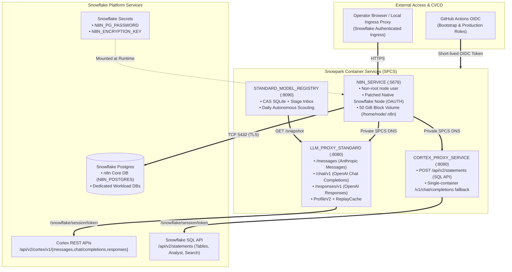

# Architecture

## System Topology

---

## Runtime Components

### 1. n8n Service (`N8N_SERVICE`)

The n8n container runs as the non-root `node` user. It stores workflow metadata, credentials, execution history, and webhook state in Snowflake Postgres. A persistent 50 GiB SPCS block volume is mounted at `/home/node/.n8n` for local configuration, community nodes, and temporary files.

The public endpoint is protected by Snowflake ingress. Access requires a Snowflake identity or a valid Snowflake programmatic access token for the endpoint.

### 2. Native Snowflake Node (`patch-snowflake-spcs-oauth.js`)

SPCS writes a short-lived service OAuth token to `/snowflake/session/token` and refreshes it periodically. The image patches n8n's native Snowflake node so each new database connection reads the current token and uses `SNOWFLAKE_HOST`, `SNOWFLAKE_ACCOUNT`, and `authenticator=OAUTH`.

This avoids passwords, key pairs, and PATs inside the n8n container.

### 3. Universal Multi-API LLM Proxy (`LLM_PROXY_STANDARD` + `STANDARD_MODEL_REGISTRY`)

Provided by the companion repository [**`fbattaglieri-snowflake/snowflake-proxy-cortexrestapi`**](https://github.com/fbattaglieri-snowflake/snowflake-proxy-cortexrestapi), the Universal LLM Proxy exposes all three Snowflake Cortex REST API protocols (`/messages`, `/chat/v1`, `/responses/v1`) to n8n AI nodes over private SPCS DNS:

- **Protocol-Specific Credentials:** n8n connects via three dedicated credentials (`Anthropic` on `/messages`, `OpenAI` with `responsesApiEnabled=false` on `/chat/v1`, and `OpenAI` with `responsesApiEnabled=true` on `/responses/v1`).
- **`ProfileV2` Normalization & `ReplayCache`:** Normalizes client parameters (`store=false`, empty `text={}`, `reasoning_effort`, thinking budgets) and automatically rehydrates opaque `reasoning.encrypted_content` and `thinking` signatures across multi-turn n8n tool executions.
- **Autonomous Daily Model Scouting:** Automatically discovers, qualifies, promotes, and revokes Cortex models as the Snowflake account catalog evolves.

### 4. SQL API & Fallback Proxy (`CORTEX_PROXY_SERVICE`)

The bundled proxy (`proxy/cortex/cortex_proxy.py`) handles two integration needs:

- Forwards parameterized SQL statements (`POST /api/v2/statements`) to the Snowflake SQL API using `/snowflake/session/token` (used for standard tables, Cortex Analyst `DATA_AGENT_RUN`, and Cortex Search `SEARCH_PREVIEW`).
- Provides a lightweight single-container `/v1/chat/completions` fallback when deployed without the full Universal LLM Proxy.

### 5. Snowflake Postgres

Snowflake Postgres provides the durable transactional database required by n8n (`N8N_POSTGRES`), as well as optional dedicated OLTP instances for workflow state (such as `MEMORY_DEMO_PG` in the Memory Tour example). The application password is stored as a Snowflake Secret and injected into the n8n service. The repository never writes that password to GitHub logs or files.

### 6. GitHub Actions OIDC

GitHub Actions uses two Snowflake service users:

- A **bootstrap identity** that can create the deployment objects.
- A **production identity** limited to image publication, staged specifications, service upgrades, and verification.

Each identity trusts only the corresponding protected GitHub environment subject.

---

## Network Boundaries

- **n8n Ingress:** Public HTTPS endpoint authenticated by Snowflake ingress.
- **Internal Proxies (`LLM_PROXY_STANDARD` and `CORTEX_PROXY_SERVICE`):** Private to SPCS (`.svc.spcs.internal`), never exposed publicly.
- **Snowflake Postgres:** Accepts only the explicitly configured ingress CIDR over TLS on port `5432`.
- **n8n Egress:** Controlled through an explicit External Access Integration.
- **Pull Request CI:** Has zero Snowflake identity and zero deployment permissions.
