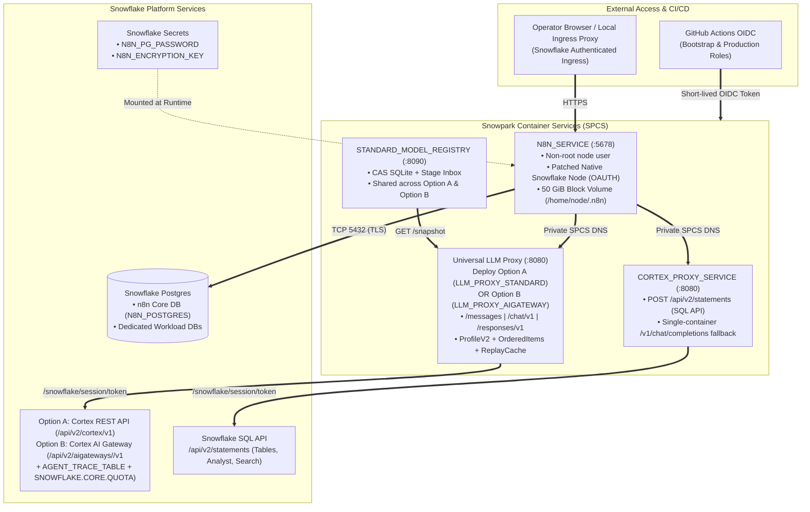

# Architecture

## System Topology

---

## Runtime Components

### 1. n8n Service (`N8N_SERVICE`)

The n8n container runs as the non-root `node` user. It stores workflow metadata, credentials, execution history, and webhook state in Snowflake Postgres. A persistent 50 GiB SPCS block volume is mounted at `/home/node/.n8n` for local configuration, community nodes, and temporary files.

The public endpoint is protected by Snowflake ingress. Access requires a Snowflake identity or a valid Snowflake programmatic access token for the endpoint.

### 2. Native Snowflake Node (`patch-snowflake-spcs-oauth.js`)

SPCS writes a short-lived service OAuth token to `/snowflake/session/token` and refreshes it periodically. The image patches n8n's native Snowflake node so each new database connection reads the current token and uses `SNOWFLAKE_HOST`, `SNOWFLAKE_ACCOUNT`, and `authenticator=OAUTH`.

This avoids passwords, key pairs, and PATs inside the n8n container.

### 3. Universal Multi-API LLM Proxy — Option A OR Option B (+ `STANDARD_MODEL_REGISTRY`)

n8n requires **either** of the two companion Universal LLM Proxies over private SPCS DNS:

- **Option A — [`snowflake-proxy-cortexrestapi`](https://github.com/fbattaglieri-snowflake/snowflake-proxy-cortexrestapi) (`LLM_PROXY_STANDARD :8080`)**: Routes `/messages`, `/chat/v1`, and `/responses/v1` to the [Snowflake Cortex REST API](https://docs.snowflake.com/en/user-guide/snowflake-cortex/cortex-rest-api) (`/api/v2/cortex/v1`).
- **Option B — [`snowflake-proxy-cortex-aigateway`](https://github.com/fbattaglieri-snowflake/snowflake-proxy-cortex-aigateway) (`LLM_PROXY_AIGATEWAY :8080`)**: Routes `/messages`, `/chat/v1`, `/responses/v1`, and `POST /telemetry/v1/traces` to [Snowflake Cortex AI Gateway](https://docs.snowflake.com/en/user-guide/snowflake-cortex/ai-gateway) (`/api/v2/aigateways/<gateway>/v1`), adding centralized `ALTER AI GATEWAY` model allowlists, W3C `traceparent` + `snow-agent-name` correlation in `TABLE(AGENT_TRACE_TABLE('<GATEWAY>'))`, `AI_GATEWAY_USAGE_HISTORY` accounting, and blocking per-user `SNOWFLAKE.CORE.QUOTA` limits.

Both options provide:
- **Protocol-Specific Credentials:** `Anthropic` on `/messages`, `OpenAI` (`responsesApiEnabled=false`) on `/chat/v1`, and `OpenAI` (`responsesApiEnabled=true`) on `/responses/v1`, each serving live `GET /<protocol>/v1/models` discovery.
- **`ProfileV2` Normalization, `OrderedItems` SSE & `ReplayCache`:** Normalizes client parameters (`store=false`, empty `text={}`, `max_tokens` &rarr; `max_completion_tokens`, adaptive thinking budgets), stabilizes streamed Responses items, retries transient `HTTP 429/503/529` responses, and rehydrates opaque `reasoning.encrypted_content` and `thinking` signatures across multi-turn n8n tool executions.
- **Shared Single-Writer Registry (`STANDARD_MODEL_REGISTRY :8090`):** Discovers, qualifies, promotes, and revokes Cortex models zero-touch, and can be shared by both Option A and Option B on a single `CPU_X64_XS` compute pool.

See [Cortex Proxy vs. AI Gateway Guide](cortex-proxy.md) for the complete comparison table.

### 4. SQL API & Fallback Proxy (`CORTEX_PROXY_SERVICE`)

The bundled proxy (`proxy/cortex/cortex_proxy.py`) handles two integration needs:

- Forwards parameterized SQL statements (`POST /api/v2/statements`) to the [Snowflake SQL API](https://docs.snowflake.com/en/developer-guide/sql-api/intro) using `/snowflake/session/token` (used for standard tables, Cortex Analyst `DATA_AGENT_RUN`, and Cortex Search `SEARCH_PREVIEW`).
- Provides a lightweight single-container `/v1/chat/completions` fallback when evaluating basic single-turn prompts before deploying Option A or Option B.

### 5. Snowflake Postgres

Snowflake Postgres provides the durable transactional database required by n8n (`N8N_POSTGRES`), as well as optional dedicated OLTP instances for workflow state (such as `MEMORY_DEMO_PG` in [`examples/memory-tour`](../examples/memory-tour)). The application password is stored as a Snowflake Secret and injected into the n8n service.

### 6. GitHub Actions OIDC

GitHub Actions uses two Snowflake service users:

- A **bootstrap identity** that can create the deployment objects.
- A **production identity** limited to image publication, staged specifications, service upgrades, and verification.

Each identity trusts only the corresponding protected GitHub environment subject.

---

## Network Boundaries

- **n8n Ingress:** Public HTTPS endpoint authenticated by Snowflake ingress.
- **Internal Proxies (`LLM_PROXY_STANDARD` / `LLM_PROXY_AIGATEWAY` and `CORTEX_PROXY_SERVICE`):** Private to SPCS (`.svc.spcs.internal`), never exposed publicly.
- **Snowflake Postgres:** Accepts only the explicitly configured ingress CIDR over TLS on port `5432`.
- **n8n Egress:** Controlled through an explicit External Access Integration.
- **Pull Request CI:** Has zero Snowflake identity and zero deployment permissions.
