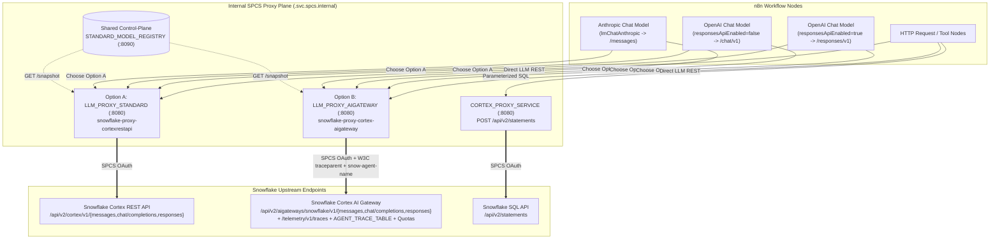

# Cortex Inference Layer: Cortex REST API Proxy vs. Cortex AI Gateway Proxy (+ SQL API Proxy)

## 1. Why an Internal SPCS LLM Proxy Is Mandatory

Inside **Snowpark Container Services (SPCS)**, Snowflake enforces two platform invariants that affect every n8n workflow:

1. **No Bearer PATs Inside Containers:** Calling Snowflake REST endpoints from inside an SPCS container with a Programmatic Access Token fails immediately with `Please use OAuth when connecting to Snowflake`. Every upstream call must read the rotating OAuth token mounted at `/snowflake/session/token` and send `X-Snowflake-Authorization-Token-Type: OAUTH`.
2. **Protocol & State Normalization for Unmodified n8n Nodes:** Neither `/api/v2/cortex/v1` nor `/api/v2/aigateways/<gateway>/v1` exposes `GET /v1/models` (`HTTP 404`), and unpatched n8n AI Agent loops strip opaque `reasoning.encrypted_content` (Responses) and `thinking.signature` blocks (Messages) between tool calls while sending incompatible parameters (`store: true`, empty `text: {}`, legacy `max_tokens`, or `temperature` alongside extended/adaptive thinking).

To run n8n AI Agents and LLM chains cleanly inside SPCS, **you must deploy at least ONE of the two companion Universal LLM Proxies** alongside the bundled `CORTEX_PROXY_SERVICE` (SQL API):

- **Option A — Cortex REST API Proxy:** [**`fbattaglieri-snowflake/snowflake-proxy-cortexrestapi`**](https://github.com/fbattaglieri-snowflake/snowflake-proxy-cortexrestapi)
- **Option B — Cortex AI Gateway Proxy:** [**`fbattaglieri-snowflake/snowflake-proxy-cortex-aigateway`**](https://github.com/fbattaglieri-snowflake/snowflake-proxy-cortex-aigateway)

---

## 2. Architectural & Governance Comparison: Option A vs. Option B

Both companion proxies share **100% of the same data-plane engine** (`ProfileV2` option normalization, `OrderedItems` SSE stream stabilizer, `ReplayCache` multi-turn rehydration, 100s `HTTP 429/503/529` backoff retry, and single-writer `STANDARD_MODEL_REGISTRY :8090`). They differ in **which Snowflake upstream control plane** receives your inference traffic:



| Dimension | Option A: Cortex REST API Proxy (`snowflake-proxy-cortexrestapi`) | Option B: Cortex AI Gateway Proxy (`snowflake-proxy-cortex-aigateway`) |
|---|---|---|
| **Official Snowflake Docs** | [Snowflake Cortex REST API](https://docs.snowflake.com/en/user-guide/snowflake-cortex/cortex-rest-api) | [Snowflake Cortex AI Gateway](https://docs.snowflake.com/en/user-guide/snowflake-cortex/ai-gateway) |
| **Upstream Base Path** | `https://<host>/api/v2/cortex/v1` | `https://<host>/api/v2/aigateways/<gateway>/v1` |
| **Model Governance** | Account `CORTEX_MODELS_ALLOWLIST` + Registry catalog | Explicit gateway YAML allowlist (`ALTER AI GATEWAY <name> SET SPECIFICATION`) |
| **OpenTelemetry Tracing** | Not written to `AGENT_TRACE_TABLE` | Server spans + request/response payloads recorded in `TABLE(AGENT_TRACE_TABLE('<GATEWAY>'))` |
| **Trace & Agent Attribution** | Local proxy headers only | Synthesizes 128-bit W3C `traceparent` when omitted + maps `client:<agent>` API key &rarr; `snow-agent-name` + forwards `POST /telemetry/v1/traces` |
| **Account Usage View** | `SNOWFLAKE.ACCOUNT_USAGE.CORTEX_REST_API_USAGE_HISTORY` | `SNOWFLAKE.ACCOUNT_USAGE.AI_GATEWAY_USAGE_HISTORY` |
| **Per-User Blocking Quotas** | Account/Warehouse budgets | Blocking per-user quotas via `SNOWFLAKE.CORE.QUOTA` (`ADD_SHARED_RESOURCE('AI GATEWAY')`) |
| **Snowflake Privileges** | `SNOWFLAKE.CORTEX_USER` or `SNOWFLAKE.CORTEX_REST_API_USER` | `USAGE` on `AI GATEWAY <name>` (`MONITOR` to inspect traces) |
| **Protocol Routing Rule** | Claude on `/messages`, OpenAI/Grok/GLM/Kimi on `/chat/v1` or `/responses/v1` | Same (note: raw AI Gateway strictly rejects Claude on `/v1/chat/completions`, which the proxy prevents by exposing Claude exclusively on `/messages`) |
| **Co-Hosting Support** | Shares `STANDARD_MODEL_REGISTRY (:8090)` with Option B | Shares `STANDARD_MODEL_REGISTRY (:8090)` with Option A |

---

## 3. Configuring the Three Credentials in n8n (Option A or Option B)

Find the internal SPCS DNS name of your deployed proxy (`SHOW SERVICES LIKE 'LLM_PROXY_%'`, column `dns_name`):
- **Option A:** `ORIGIN = http://<llm-proxy-standard-dns>:8080`
- **Option B:** `ORIGIN = http://<llm-proxy-aigateway-dns>:8080`

Create **three credentials** in n8n (**Settings → Credentials → Add Credential**). Set **API Key** to `client:n8n-spcs` — neither proxy ever sends this value upstream, and Option B automatically extracts `n8n-spcs` into the `snow-agent-name` header in `TABLE(AGENT_TRACE_TABLE('SNOWFLAKE'))`:

### Credential 1 — Anthropic Messages API (`/messages`)
- **Credential Type:** `Anthropic` (`anthropicApi`)
- **Base URL (`url`):** `ORIGIN/messages`
- **API Key:** `client:n8n-spcs`
- **n8n Node:** **Anthropic Chat Model** (`@n8n/n8n-nodes-langchain.lmChatAnthropic`)
- **Qualified Models:** `claude-sonnet-5-5`, `claude-opus-5-5`, `claude-haiku-5-5` (populated dynamically from `GET /messages/v1/models`)

### Credential 2 — OpenAI Chat Completions API (`/chat/v1`)
- **Credential Type:** `OpenAI` (`openAiApi`)
- **Base URL (`url`):** `ORIGIN/chat/v1`
- **API Key:** `client:n8n-spcs`
- **n8n Node:** **OpenAI Chat Model** (`@n8n/n8n-nodes-langchain.lmChatOpenAi`) with **Use Responses API = `OFF`** (`responsesApiEnabled: false`, leave `maxTokens` unset)
- **Qualified Models:** `openai-gpt-6-luna`, `openai-gpt-6-sol`, `grok-4.7`, `grok-4.6`, `glm-5.3`, `kimi-k3`

### Credential 3 — OpenAI Responses API (`/responses/v1`)
- **Credential Type:** `OpenAI` (`openAiApi`)
- **Base URL (`url`):** `ORIGIN/responses/v1`
- **API Key:** `client:n8n-spcs`
- **n8n Node:** **OpenAI Chat Model** (`@n8n/n8n-nodes-langchain.lmChatOpenAi`) with **Use Responses API = `ON`** (`responsesApiEnabled: true`)
- **Qualified Models:** `openai-gpt-6.1-terra`, `openai-gpt-6.1-sol`, `openai-gpt-6-astra`

---

## 4. Direct HTTP Request Node Patterns (Scheduled Digests, RAG & Triage)

When calling Cortex LLMs from a standard n8n **HTTP Request** node (`n8n-nodes-base.httpRequest`), point to `ORIGIN` (either `llm-proxy-standard` or `llm-proxy-aigateway`). On Option B, you can also pass a per-workflow `"snow-agent-name"` header to separate each workflow in `AGENT_TRACE_TABLE`:

| Protocol | HTTP Method & URL | Recommended Headers | Response Text Extraction |
|---|---|---|---|
| **Messages (`claude-*`)** | `POST ORIGIN/messages/v1/messages` | `{"Content-Type": "application/json", "x-api-key": "client:my-workflow", "snow-agent-name": "my-workflow", "anthropic-version": "2023-06-01"}` | `resp.content.filter(b => b.type === 'text').map(b => b.text).join('\n')` |
| **Chat Completions** | `POST ORIGIN/chat/v1/chat/completions` | `{"Content-Type": "application/json", "Authorization": "Bearer client:my-workflow", "snow-agent-name": "my-workflow"}` | `resp.choices[0].message.content` |
| **Responses API** | `POST ORIGIN/responses/v1/responses` | `{"Content-Type": "application/json", "Authorization": "Bearer client:my-workflow", "snow-agent-name": "my-workflow"}` | `resp.output_text` (or `resp.output` message items) |

---

## 5. Configuring & Querying Cortex AI Gateway in Snowflake (Option B)

```sql
-- 1. Configure AI Gateway model allowlist & OpenTelemetry payload capture
ALTER AI GATEWAY SNOWFLAKE SET SPECIFICATION
$$
schema_version: 1
models:
  - name: claude-opus-5-5
  - name: claude-sonnet-5-5
  - name: claude-haiku-5-5
  - name: openai-gpt-6-luna
  - name: openai-gpt-6.1-terra
  - name: openai-gpt-6-astra
  - name: grok-4.7
  - name: kimi-k3
logging:
  enabled: true
  enable_client_telemetry: true
  capture_payload:
    request_response: true
$$;

-- 2. Optional: enforce blocking per-user quotas on Cortex AI Gateway
CREATE SNOWFLAKE.CORE.QUOTA ai_gateway_daily_quota
  LIMIT = 100
  REFRESH_INTERVAL = '1 day';
CALL ai_gateway_daily_quota!ADD_SHARED_RESOURCE('AI GATEWAY', 'SNOWFLAKE');

-- 3. Inspect n8n workflow traces in Snowflake
SELECT
  TIMESTAMP,
  TRACE:"trace_id"::STRING AS TRACE_ID,
  RECORD:"name"::STRING AS SPAN_NAME,
  RECORD_ATTRIBUTES:"http.request.header.snow-agent-name"::STRING AS WORKFLOW_AGENT,
  RECORD_ATTRIBUTES:"gen_ai.request.model"::STRING AS MODEL,
  RECORD_ATTRIBUTES:"gen_ai.usage.input_tokens"::INT AS INPUT_TOKENS,
  RECORD_ATTRIBUTES:"gen_ai.usage.output_tokens"::INT AS OUTPUT_TOKENS,
  RECORD_ATTRIBUTES:"http.response.status_code"::INT AS HTTP_STATUS
FROM TABLE(AGENT_TRACE_TABLE('SNOWFLAKE'))
ORDER BY TIMESTAMP DESC
LIMIT 20;
```

---

## 6. Bundled SQL API & Fallback Proxy (`CORTEX_PROXY_SERVICE`)

The proxy included in `proxy/cortex/cortex_proxy.py` (`CORTEX_PROXY_SERVICE :8080`) exposes:

- `POST /api/v2/statements`: forwards parameterized SQL statements to the [Snowflake SQL API](https://docs.snowflake.com/en/developer-guide/sql-api/intro) using `/snowflake/session/token`.
- `POST /v1/chat/completions` and `GET /v1/models`: lightweight single-container OpenAI Chat Completions fallback.
- `GET /healthz`: container health check.

**SQL Safety Rule:** Always use Snowflake SQL API parameter `bindings` with stringified scalar values (`?` placeholders with `bindings: { "1": { "type": "TEXT", "value": String(val) } }`). Never concatenate LLM output, user input, or workflow variables into SQL strings.
