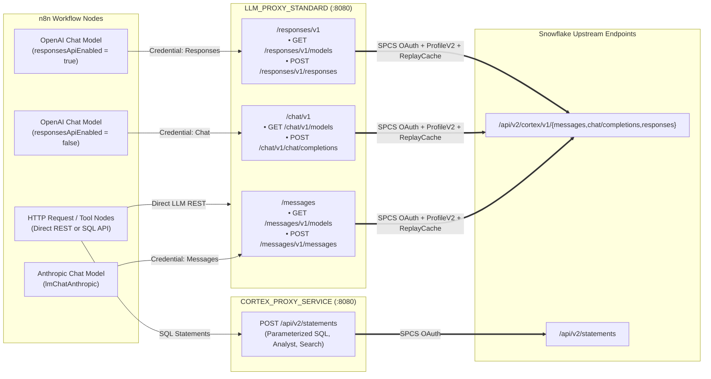

# Cortex Universal LLM Proxy & SQL API Proxy

## Overview

Inside Snowpark Container Services (SPCS), Snowflake forbids static bearer Programmatic Access Tokens (PATs) and requires every upstream request to carry the rotating in-container OAuth token from `/snowflake/session/token` (`X-Snowflake-Authorization-Token-Type: OAUTH`).

This deployment uses a clean **two-plane internal proxy architecture** over private SPCS DNS (`.svc.spcs.internal`):

1. **Universal Multi-API LLM Proxy (`LLM_PROXY_STANDARD :8080`)** — provided by the companion repository [**`fbattaglieri-snowflake/snowflake-proxy-cortexrestapi`**](https://github.com/fbattaglieri-snowflake/snowflake-proxy-cortexrestapi). It exposes all three native Snowflake Cortex REST API protocols (**Anthropic Messages**, **OpenAI Chat Completions**, and **OpenAI Responses**) with `ProfileV2` parameter normalization, `ReplayCache` multi-turn state rehydration, and dynamic `/models` discovery.
2. **SQL API & Fallback Proxy (`CORTEX_PROXY_SERVICE :8080`)** — bundled in this repository (`proxy/cortex/cortex_proxy.py`). It forwards parameterized SQL statements (`POST /api/v2/statements`) for standard tables, Cortex Analyst (`DATA_AGENT_RUN`), and Cortex Search (`SEARCH_PREVIEW`), and also provides a lightweight single-container `/v1/chat/completions` fallback.



---

## 1. Configuring the Three Universal LLM Proxy Credentials in n8n

Find the internal DNS name of `LLM_PROXY_STANDARD` with `SHOW SERVICES LIKE 'LLM_PROXY_STANDARD'` (column `dns_name`), and let:

```text
ORIGIN = http://<llm-proxy-standard-dns-name>:8080
```

Create **three credentials** in n8n (**Settings → Credentials → Add Credential**). Because the proxy injects the SPCS service OAuth token on every request, use a non-secret placeholder string (`internal-spcs`) as the API key:

### Credential A — Anthropic Messages API (`/messages`)
- **Credential Type:** `Anthropic` (`anthropicApi`)
- **Name:** `Snowflake Cortex Standard - Messages (/messages)`
- **Base URL (`url`):** `http://<llm-proxy-standard-dns-name>:8080/messages`
- **API Key:** `internal-spcs`
- **n8n Node:** **Anthropic Chat Model** (`@n8n/n8n-nodes-langchain.lmChatAnthropic`)
- **Supported Models:** `claude-sonnet-5-5`, `claude-opus-5-5`, `claude-haiku-5-5` (discovered dynamically from `GET /messages/v1/models`)

### Credential B — OpenAI Chat Completions API (`/chat/v1`)
- **Credential Type:** `OpenAI` (`openAiApi`)
- **Name:** `Snowflake Cortex Standard - Chat (/chat/v1)`
- **Base URL (`url`):** `http://<llm-proxy-standard-dns-name>:8080/chat/v1`
- **API Key:** `internal-spcs`
- **n8n Node:** **OpenAI Chat Model** (`@n8n/n8n-nodes-langchain.lmChatOpenAi`) with **Use Responses API = `OFF`** (`responsesApiEnabled: false`)
- **Important Node Option:** Leave `Maximum Number of Tokens` (`maxTokens`) **unset** in the node UI so n8n does not emit the deprecated `"max_tokens"` field rejected by Cortex Chat Completions.
- **Supported Models:** `openai-gpt-6-luna`, `openai-gpt-6-sol`, `grok-4.7`, `grok-4.6`, `glm-5.3`, `kimi-k3` (discovered dynamically from `GET /chat/v1/models`)

### Credential C — OpenAI Responses API (`/responses/v1`)
- **Credential Type:** `OpenAI` (`openAiApi`)
- **Name:** `Snowflake Cortex Standard - Responses (/responses/v1)`
- **Base URL (`url`):** `http://<llm-proxy-standard-dns-name>:8080/responses/v1`
- **API Key:** `internal-spcs`
- **n8n Node:** **OpenAI Chat Model** (`@n8n/n8n-nodes-langchain.lmChatOpenAi`) with **Use Responses API = `ON`** (`responsesApiEnabled: true`)
- **Supported Models:** `openai-gpt-6.1-terra`, `openai-gpt-6.1-sol`, `openai-gpt-6-astra` (discovered dynamically from `GET /responses/v1/models`)

---

## 2. Direct HTTP Request Node Patterns (Non-Agent Workflows)

When calling Cortex LLMs from a standard n8n **HTTP Request** node (`n8n-nodes-base.httpRequest`) — for example in scheduled digest or RAG pipelines — call the corresponding protocol endpoint on `LLM_PROXY_STANDARD`:

| Protocol | HTTP Method & URL | Required Headers | Response Text Path |
|---|---|---|---|
| **Messages (`claude-*`)** | `POST http://<llm-proxy-standard-dns>:8080/messages/v1/messages` | `{"Content-Type": "application/json", "x-api-key": "internal-spcs", "anthropic-version": "2023-06-01"}` | `resp.content.filter(b => b.type === 'text').map(b => b.text).join('\n')` |
| **Chat Completions** | `POST http://<llm-proxy-standard-dns>:8080/chat/v1/chat/completions` | `{"Content-Type": "application/json", "Authorization": "Bearer internal-spcs"}` | `resp.choices[0].message.content` |
| **Responses API** | `POST http://<llm-proxy-standard-dns>:8080/responses/v1/responses` | `{"Content-Type": "application/json", "Authorization": "Bearer internal-spcs"}` | `resp.output_text` (or `resp.output` message items) |

### Example: Direct Anthropic Messages Call (`claude-sonnet-5-5`)

```javascript
{{ JSON.stringify({
  model: "claude-sonnet-5-5",
  max_tokens: 4096,
  temperature: 0.2,
  system: $json.system_prompt,
  messages: [
    { role: "user", content: $json.user_question }
  ]
}) }}
```

---

## 3. What the Universal LLM Proxy Normalizes Automatically

- **Stateless `ReplayCache` for Multi-Turn Tool Loops:** When an n8n AI Agent executes tools across multiple turns, n8n's internal message serialization drops opaque reasoning fields (`reasoning.encrypted_content` on Responses and `thinking` / `signature` blocks on Messages). `LLM_PROXY_STANDARD` caches those blocks by `call_id` / `tool_use.id` and re-injects them automatically on subsequent turns.
- **Responses API Compatibility:** Forces `store: false` (even when n8n sends `store: true`), strips empty `"text": {}` objects emitted by n8n, and injects `include: ["reasoning.encrypted_content"]`.
- **Chat Completions Compatibility:** Automatically sets `reasoning_effort: "none"` on models that require it when tools are bound (`openai-gpt-6-luna`, `openai-gpt-6-sol`) and strips `reasoning_effort` on models that do not accept it (`grok-4.6`, `grok-4.7`, `kimi-k3`, `glm-5.3`).
- **Tool Call ID Deduplication:** Deterministically renames reused tool call IDs (`call_0` $\rightarrow$ `call_0_r2`) across closed tool rounds.

---

## 4. Bundled SQL API & Fallback Proxy (`CORTEX_PROXY_SERVICE`)

The proxy included in `proxy/cortex/cortex_proxy.py` (`CORTEX_PROXY_SERVICE :8080`) exposes:

- `POST /api/v2/statements`: forwards parameterized SQL statements to the Snowflake SQL API using `/snowflake/session/token`.
- `POST /v1/chat/completions` and `GET /v1/models`: single-container OpenAI Chat Completions fallback (rewrites `max_tokens` $\rightarrow$ `max_completion_tokens`, infers missing `finish_reason`, renumbers streamed tool call indices, and collapses parallel tool calls for standalone deployments).
- `GET /healthz`: container health check.

### SQL Safety Rule

Always use Snowflake SQL API parameter `bindings` for dynamic workflow values (`?` placeholders with `bindings: { "1": { "type": "TEXT", "value": ... } }`). Never concatenate LLM output, user input, or workflow variables into SQL strings.
