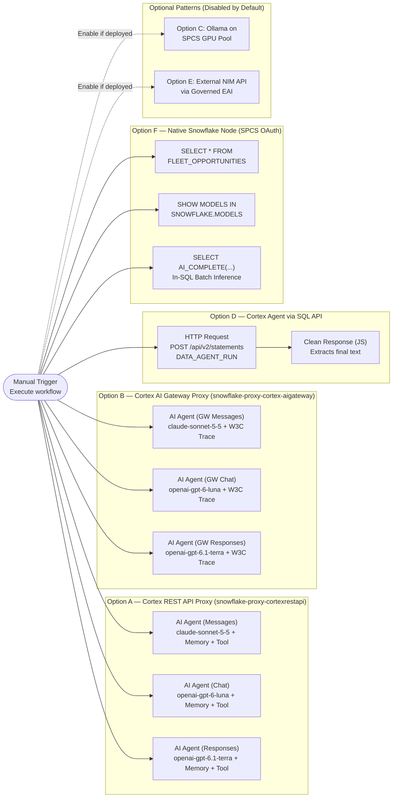

# Example 2: Multi-API LLM & Snowflake Integration Showcase (`examples/llm-options`)

A single visual reference canvas (`LLM_Options`) demonstrating **every way an n8n workflow on SPCS can invoke LLMs, Agents, and SQL on Snowflake** — side by side across **6 architectural patterns (`Options A–F`)**.

> [!IMPORTANT]
> **Self-Contained Synthetic Setup & Least-Privilege Role (`N8N_DEMO_ROLE`)**
> External readers do **not** have (and do **not** need) the maintainer's Snowflake account.
> Running the scripts in [`sql/`](sql/) provisions a dedicated least-privilege role (`N8N_DEMO_ROLE`), an auto-suspend `XSMALL` warehouse (`LLM_OPTIONS_DEMO_WH`), a synthetic industrial fleet table (`LLM_OPTIONS_DEMO.CORE.FLEET_OPPORTUNITIES`), a Semantic View (`FLEET_ANALYTICS`), and a Snowflake Cortex Agent (`PLATFORM_DOCS_AGENT`) on **your own Snowflake account**.

> [!TIP]
> **Deploy Either Cortex REST API Proxy OR Cortex AI Gateway Proxy (or Both)**
> This showcase includes both **Option A (`snowflake-proxy-cortexrestapi`)** and **Option B (`snowflake-proxy-cortex-aigateway`)** on the same canvas so you can compare them side by side.
> - If your deployment runs **only one** of the two companion proxies, either **disable the three Agent nodes of the unused row** in n8n or bind all six credentials to your deployed proxy.
> - **Options C (Self-Hosted GPU Ollama)** and **E (External API via EAI)** are shipped **`disabled: true` by default** so the workflow runs 100% inside Snowflake out of the box without requiring a GPU compute pool or third-party API key.

---

## Visual Overview of the 6 Patterns on the Canvas



---

## Pattern Matrix (`Options A–F`)

| Option | Pattern | Transport & Auth | Upstream Target | Best Used When |
|---|---|---|---|---|
| **A** | **Cortex REST API Proxy** ([`snowflake-proxy-cortexrestapi`](https://github.com/fbattaglieri-snowflake/snowflake-proxy-cortexrestapi)) | Internal SPCS HTTP (`:8080/{messages,chat/v1,responses/v1}`) + SPCS OAuth | `/api/v2/cortex/v1` | Multi-turn n8n AI Agents with tools & memory needing direct Cortex REST throughput |
| **B** | **Cortex AI Gateway Proxy** ([`snowflake-proxy-cortex-aigateway`](https://github.com/fbattaglieri-snowflake/snowflake-proxy-cortex-aigateway)) | Internal SPCS HTTP (`:8080/{messages,chat/v1,responses/v1}`) + SPCS OAuth + W3C `traceparent` | `/api/v2/aigateways/snowflake/v1` | Enterprise governance: `ALTER AI GATEWAY` model allowlists, `TABLE(AGENT_TRACE_TABLE('SNOWFLAKE'))` spans, OTLP traces & per-user `SNOWFLAKE.CORE.QUOTA` |
| **C** | **Self-Hosted Open-Weights on SPCS GPU Pool** *(optional, disabled)* | Internal SPCS HTTP (`ollama-service:11434`) | SPCS `GPU_NV_S` Compute Pool | Custom / open-weights GGUF models hosted inside Snowflake |
| **D** | **Snowflake Cortex Agent via SQL API** | `CORTEX_PROXY_SERVICE :8080/api/v2/statements` + SPCS OAuth | `SNOWFLAKE.CORTEX.DATA_AGENT_RUN` | Platform-governed orchestration combining Cortex Analyst (Semantic Views) and Cortex Search |
| **E** | **External LLM API via EAI** *(optional, disabled)* | HTTPS egress through Snowflake External Access Integration | External OpenAI-compatible / NIM endpoint | Calling a third-party model explicitly permitted by an admin-governed EAI |
| **F** | **Native n8n Snowflake Node** | Patched `n8n-nodes-base.snowflake` (`authenticator=OAUTH`) | Snowflake Warehouse (`LLM_OPTIONS_DEMO_WH`) | Direct `SELECT` queries, `SHOW MODELS`, and set-based `SELECT AI_COMPLETE(...)` |

---

## Step-by-Step Setup on Your Snowflake Account

### 1. Create `N8N_DEMO_ROLE`, Synthetic Fleet Data, Semantic View & Cortex Agent

Edit `sql/00_role_and_grants.sql` to grant `N8N_DEMO_ROLE` to your SPCS service owner role, then run:

```bash
# 1. Create least-privilege N8N_DEMO_ROLE + Cortex / AI Gateway grants
snow sql -f examples/llm-options/sql/00_role_and_grants.sql

# 2. Create LLM_OPTIONS_DEMO database, XS warehouse, FLEET_OPPORTUNITIES table & FLEET_ANALYTICS semantic view
snow sql -f examples/llm-options/sql/10_objects.sql

# 3. Load 10 deterministic synthetic fleet opportunity rows
snow sql -f examples/llm-options/sql/20_seed.sql

# 4. Deploy PLATFORM_DOCS_AGENT and grant USAGE to N8N_DEMO_ROLE
cortex agent-studio agent-deploy --file-path examples/llm-options/sql/40_agent.yaml \
  --fqn LLM_OPTIONS_DEMO.CORE.PLATFORM_DOCS_AGENT
snow sql -f examples/llm-options/sql/50_grant_agent.sql
```

### 2. Import `workflow.json` & Replace Placeholders

Import [`workflow.json`](workflow.json) into n8n and map the placeholders to your credentials:

| Placeholder | What to Replace It With |
|---|---|
| `CORTEX_PROXY_DNS_NAME` | Internal DNS name from `SHOW SERVICES LIKE 'CORTEX_PROXY_SERVICE'` (`dns_name` column) |
| `REPLACE_WITH_CORTEX_REST_MESSAGES_CREDENTIAL_ID` | Anthropic credential (`/messages`) on `llm-proxy-standard:8080` *(or disable Option A if using only Option B)* |
| `REPLACE_WITH_CORTEX_REST_CHAT_CREDENTIAL_ID` | OpenAI credential (`/chat/v1`, `Use Responses API = OFF`) on `llm-proxy-standard:8080` |
| `REPLACE_WITH_CORTEX_REST_RESPONSES_CREDENTIAL_ID` | OpenAI credential (`/responses/v1`, `Use Responses API = ON`) on `llm-proxy-standard:8080` |
| `REPLACE_WITH_AI_GATEWAY_MESSAGES_CREDENTIAL_ID` | Anthropic credential (`/messages`, `API Key = client:n8n-spcs`) on `llm-proxy-aigateway:8080` *(or disable Option B if using only Option A)* |
| `REPLACE_WITH_AI_GATEWAY_CHAT_CREDENTIAL_ID` | OpenAI credential (`/chat/v1`, `API Key = client:n8n-spcs`) on `llm-proxy-aigateway:8080` |
| `REPLACE_WITH_AI_GATEWAY_RESPONSES_CREDENTIAL_ID` | OpenAI credential (`/responses/v1`, `API Key = client:n8n-spcs`) on `llm-proxy-aigateway:8080` |
| `REPLACE_WITH_SNOWFLAKE_CREDENTIAL_ID` | Native Snowflake credential (`Database = LLM_OPTIONS_DEMO`, `Schema = CORE`, `Warehouse = LLM_OPTIONS_DEMO_WH`, `Role = N8N_DEMO_ROLE`) |

Click **Execute workflow** to run all enabled Snowflake branches in parallel and inspect each node's output and `TABLE(AGENT_TRACE_TABLE('SNOWFLAKE'))` spans.
