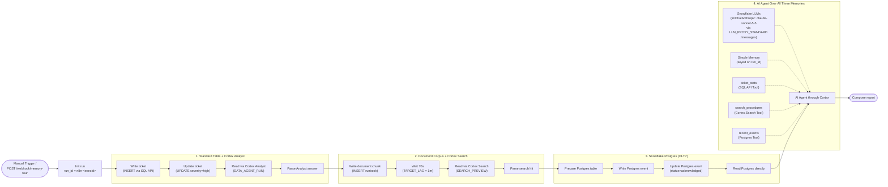

# Example: Snowflake Memory Tour

One n8n workflow that writes to and reads back from every Snowflake memory reachable
from an SPCS-hosted n8n, then lets an AI Agent reason across all of them with an LLM
served by Snowflake Cortex through the Universal Multi-API LLM Proxy ([`snowflake-proxy-cortexrestapi`](https://github.com/fbattaglieri-snowflake/snowflake-proxy-cortexrestapi)).

Nothing in this example calls an external model provider. The prompts, the data, and
the answers stay inside Snowflake.

For the patterns behind it, generalised and explained one capability at a time, read
[`docs/building-workflows.md`](../../docs/building-workflows.md).

---

## Workflow Execution Flow



---

## What It Demonstrates

| Memory | Write | Read |
|---|---|---|
| **Standard table** (`MEMORY_DEMO.CORE.SERVICE_TICKETS`) | `INSERT` and `UPDATE` over the Snowflake SQL API (`/api/v2/statements`) | Cortex Analyst in natural language (`SNOWFLAKE.CORTEX.DATA_AGENT_RUN`) |
| **Document corpus** (`MEMORY_DEMO.CORE.SERVICE_DOCS` + `DOC_SEARCH`) | `INSERT` of a new runbook chunk | Cortex Search (`SNOWFLAKE.CORTEX.SEARCH_PREVIEW`) |
| **Snowflake Postgres** (`MEMORY_DEMO_PG` / `demo_events`) | `INSERT` and `UPDATE` with the native Postgres node | Plain `SELECT`, no Cortex layer in between |
| **All three at once** | — | AI Agent with three tools (`ticket_stats`, `search_procedures`, `recent_events`) + `Simple Memory`, powered by `claude-sonnet-5-5` via `LLM_PROXY_STANDARD` (`/messages`) |

---

## Why Internal SPCS Proxies Are Used

Snowflake forbids programmatic access tokens from inside an SPCS container: a bearer
PAT is rejected with *"Please use OAuth when connecting to Snowflake from inside a
container"*. Both internal proxies read the rotating service OAuth token from
`/snowflake/session/token` on every request:

| Service & Path | Used by |
|---|---|
| `LLM_PROXY_STANDARD` — `POST /messages/v1/messages` & `GET /messages/v1/models` | The AI Agent model node (`lmChatAnthropic` with `claude-sonnet-5-5`, or `lmChatOpenAi` on `/chat/v1` and `/responses/v1`) |
| `CORTEX_PROXY_SERVICE` — `POST /api/v2/statements` | Every SQL statement, including Cortex Analyst (`DATA_AGENT_RUN`) and Cortex Search (`SEARCH_PREVIEW`) |

---

## Prerequisites

1. n8n, `LLM_PROXY_STANDARD` ([`snowflake-proxy-cortexrestapi`](https://github.com/fbattaglieri-snowflake/snowflake-proxy-cortexrestapi)), and `CORTEX_PROXY_SERVICE` deployed as described in [`docs/architecture.md`](../../docs/architecture.md).
2. A Snowflake Postgres instance reachable from the compute pool, with its host on
   port `5432` present in the egress network rule attached to the n8n service.
3. Two n8n credentials:
   - `Snowflake Cortex Standard - Messages (/messages)`, type **Anthropic** (`anthropicApi`), base URL `http://<llm-proxy-standard-dns-name>:8080/messages`, API key `internal-spcs`. See [`docs/cortex-proxy.md`](../../docs/cortex-proxy.md).
   - `Memory Demo Postgres`, type **Postgres**, SSL on, certificate verification off.

---

## Install

```bash
snow sql -f sql/10_objects.sql
snow sql -f sql/20_seed.sql
snow sql -f sql/30_cortex.sql
cortex agent-studio agent-deploy --file-path sql/40_agent.yaml \
  --fqn MEMORY_DEMO.CORE.MEMORY_DEMO_AGENT
```

Then import `workflow.json` into n8n and replace the placeholders:

| Placeholder | Where to find the real value |
|---|---|
| `CORTEX_PROXY_DNS_NAME` | `SHOW SERVICES LIKE 'CORTEX_PROXY_SERVICE'`, column `dns_name` |
| `REPLACE_WITH_YOUR_ANTHROPIC_CREDENTIAL_ID` | the ID of your `Snowflake Cortex Standard - Messages (/messages)` credential |
| `REPLACE_WITH_YOUR_POSTGRES_CREDENTIAL_ID` | the ID of your Postgres credential |

The Postgres table is created by the workflow itself with `CREATE TABLE IF NOT EXISTS`, so there is no manual DDL step on the Postgres side.

---

## Running It

Click **Execute workflow**, or `POST` to the `memory-tour` webhook. A run takes about
90–100 seconds (70 seconds of which is the deliberate `Wait for search lag` node so `DOC_SEARCH` indexes the newly inserted runbook chunk). The final Code node outputs a structured report verifying all four stages.

---

## Key Operational Notes

- **Cortex Search has a target lag.** `DOC_SEARCH` is created with `TARGET_LAG = '1 minute'`, and the workflow waits 70 seconds before searching so it can retrieve the chunk written earlier in the same execution.
- **Parameter binding is mandatory.** Concatenating values into SQL statements fails with `HTTP 422` as soon as a value contains an apostrophe.
- **Use the tool variants of regular nodes.** Use `n8n-nodes-base.httpRequestTool` and `n8n-nodes-base.postgresTool` with `$fromAI(...)` parameters.
- **`Simple Memory` requires an explicit session key.** In non-chat workflows, set `sessionIdType: "customKey"` (keyed on `run_id` here).
