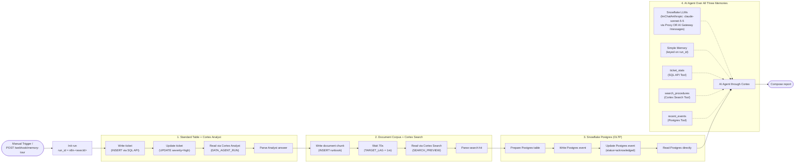

# Example 1: Snowflake Memory Tour (`examples/memory-tour`)

One self-contained n8n workflow that writes to and reads back from **every Snowflake memory** reachable from an SPCS-hosted n8n instance, then lets an **AI Agent** reason across all of them using an LLM served 100% inside Snowflake.

> [!IMPORTANT]
> **Self-Contained Synthetic Data & Least-Privilege Role Setup**
> You do **not** have (and do **not** need) the maintainer's Snowflake account to run this example.
> All required databases, synthetic field-service tickets, synthetic maintenance runbooks, Cortex Search index, Semantic View, Cortex Agent, and the dedicated least-privilege runtime role **`MEMORY_DEMO_ROLE`** are created automatically on **your own Snowflake account** by the scripts in [`sql/`](sql/).

> [!NOTE]
> **Works with Either Companion LLM Proxy**
> The `Snowflake LLMs` node (`claude-sonnet-5-5` over `/messages`) works identically against **either**:
> - **Option A — Cortex REST API Proxy:** [`snowflake-proxy-cortexrestapi`](https://github.com/fbattaglieri-snowflake/snowflake-proxy-cortexrestapi) (`http://<llm-proxy-standard-dns>:8080/messages`)
> - **Option B — Cortex AI Gateway Proxy:** [`snowflake-proxy-cortex-aigateway`](https://github.com/fbattaglieri-snowflake/snowflake-proxy-cortex-aigateway) (`http://<llm-proxy-aigateway-dns>:8080/messages`), which additionally records OpenTelemetry server spans in `TABLE(AGENT_TRACE_TABLE('SNOWFLAKE'))` and enforces `AI GATEWAY SNOWFLAKE` model allowlists and `SNOWFLAKE.CORE.QUOTA` limits.
>
> See [`docs/cortex-proxy.md`](../../docs/cortex-proxy.md) for a full comparison and links to official Snowflake documentation.

---

## Workflow Execution Flow



---

## What It Demonstrates

| Memory Layer | Write Path | Read Path | Runtime Role / Auth |
|---|---|---|---|
| **Standard Table** (`MEMORY_DEMO.CORE.SERVICE_TICKETS`) | Parameterized `INSERT` and `UPDATE` over `/api/v2/statements` | Natural-language query via Cortex Analyst (`SNOWFLAKE.CORTEX.DATA_AGENT_RUN`) | `MEMORY_DEMO_ROLE` via SPCS OAuth |
| **Document Corpus** (`MEMORY_DEMO.CORE.SERVICE_DOCS` + `DOC_SEARCH`) | Parameterized `INSERT` of a new runbook chunk | Semantic retrieval via Cortex Search (`SNOWFLAKE.CORTEX.SEARCH_PREVIEW`) | `MEMORY_DEMO_ROLE` via SPCS OAuth |
| **Snowflake Postgres** (`demo_events`) | Native Postgres `INSERT` and `UPDATE ... RETURNING` | Direct transactional `SELECT` | Postgres credential over TLS (`:5432`) |
| **Multi-Memory AI Agent** | — | Calls `ticket_stats`, `search_procedures`, and `recent_events` in one reasoning loop (`claude-sonnet-5-5`) | Either Cortex REST API Proxy or Cortex AI Gateway Proxy |

---

## Step-by-Step Setup on Your Snowflake Account

### 1. Provision Role, Synthetic Data, Cortex Search, Semantic View & Agent

Edit `sql/00_role_and_grants.sql` to uncomment `GRANT ROLE MEMORY_DEMO_ROLE TO ROLE <YOUR_SPCS_SERVICE_OWNER_ROLE>;` so your `CORTEX_PROXY_SERVICE` owner role can execute statements as `MEMORY_DEMO_ROLE`, then run the scripts in order:

```bash
# 1. Create least-privilege MEMORY_DEMO_ROLE + Cortex / AI Gateway grants
snow sql -f examples/memory-tour/sql/00_role_and_grants.sql

# 2. Create MEMORY_DEMO database, MEMORY_DEMO_WH warehouse, tables & table grants
snow sql -f examples/memory-tour/sql/10_objects.sql

# 3. Load deterministic synthetic seed data (30 field-service tickets + 8 safety/maintenance docs)
snow sql -f examples/memory-tour/sql/20_seed.sql

# 4. Create Cortex Search service (DOC_SEARCH) & Semantic View (TICKETS_ANALYTICS) + grants
snow sql -f examples/memory-tour/sql/30_cortex.sql

# 5. Deploy the Cortex Agent for Cortex Analyst text-to-SQL and grant USAGE to MEMORY_DEMO_ROLE
cortex agent-studio agent-deploy --file-path examples/memory-tour/sql/40_agent.yaml \
  --fqn MEMORY_DEMO.CORE.MEMORY_DEMO_AGENT
snow sql -f examples/memory-tour/sql/50_grant_agent.sql
```

### 2. Import `workflow.json` into n8n & Bind Your Credentials

Import [`workflow.json`](workflow.json) into n8n and replace the three placeholders:

| Placeholder | Value on Your Deployment |
|---|---|
| `CORTEX_PROXY_DNS_NAME` | Internal DNS name from `SHOW SERVICES LIKE 'CORTEX_PROXY_SERVICE'` (`dns_name` column) |
| `REPLACE_WITH_YOUR_ANTHROPIC_CREDENTIAL_ID` | Credential ID of your **Anthropic** (`/messages`) credential pointing to **either** `llm-proxy-standard:8080/messages` **or** `llm-proxy-aigateway:8080/messages` (`API Key = client:n8n-spcs`) |
| `REPLACE_WITH_YOUR_POSTGRES_CREDENTIAL_ID` | Credential ID of your Snowflake Postgres credential (SSL enabled, certificate verification off) |

> The Postgres `demo_events` table is created idempotently at runtime (`CREATE TABLE IF NOT EXISTS demo_events ...`), so no manual DDL step is required on Postgres.

---

## Running & Verifying the Tour

Click **Execute workflow** in n8n (or send `POST /webhook/memory-tour`). Execution takes ~95 seconds because `Wait for search lag` pauses 70 seconds to let `DOC_SEARCH` (`TARGET_LAG = '1 minute'`) index the runbook chunk written earlier in the same run.

When routed through **Cortex AI Gateway Proxy** (`snowflake-proxy-cortex-aigateway`), you can also inspect the multi-turn agent spans in Snowflake immediately after completion:

```sql
SELECT
  TIMESTAMP,
  TRACE:"trace_id"::STRING AS TRACE_ID,
  RECORD:"name"::STRING AS SPAN_NAME,
  RECORD_ATTRIBUTES:"http.request.header.snow-agent-name"::STRING AS AGENT_NAME,
  RECORD_ATTRIBUTES:"gen_ai.usage.input_tokens"::INT AS INPUT_TOKENS,
  RECORD_ATTRIBUTES:"gen_ai.usage.output_tokens"::INT AS OUTPUT_TOKENS
FROM TABLE(AGENT_TRACE_TABLE('SNOWFLAKE'))
ORDER BY TIMESTAMP DESC
LIMIT 5;
```
